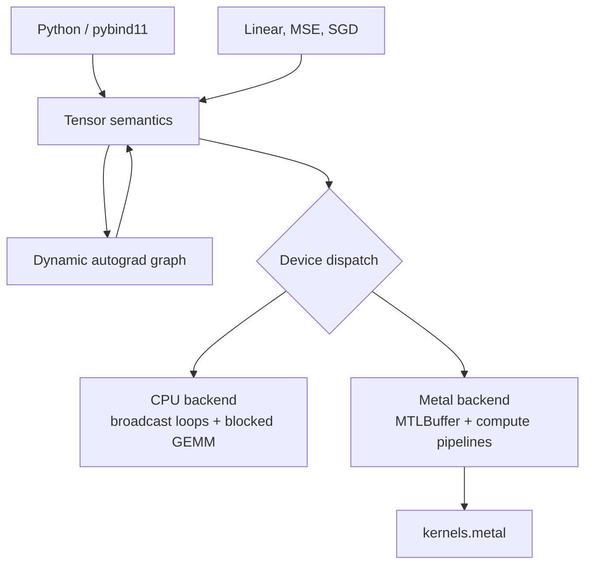

# VectorCore

VectorCore is a from-scratch C++20 tensor and reverse-mode automatic-differentiation runtime. It has a native CPU backend, a real Apple Metal compute backend, Python bindings through pybind11, neural-network training examples, numerical tests against NumPy and PyTorch, and reproducible benchmarks.

The core does **not** call NumPy, PyTorch, Eigen, or another tensor library. NumPy and PyTorch appear only in Python tests and benchmarks as references.

## What works

- float32 scalar, vector, matrix, and higher-rank tensors
- checked shapes, contiguous strides, indexing, reshape/flatten views, and 2-D transpose
- stride-based NumPy-style broadcasting without expanded operand copies
- add, subtract, multiply, divide, negate, exp, log, ReLU, sigmoid
- reductions over all elements or along one axis (with `keepdim`): sum, mean, max, and non-differentiable argmax
- numerically stable softmax / log-softmax along any axis, and softmax cross-entropy with integer class targets
- batched matrix multiplication with NumPy-style broadcasting of batch dimensions, and batched last-two-axis transpose
- dynamic computation graphs and reverse-mode gradients for every operation above
- PyTorch-style safety: storage version counters reject `backward()` when a tensor saved for the gradient was modified in place (for example by `sgd_step`) after the forward pass
- leaf-only `.grad` retention with an opt-in `retain_grad()` for intermediates; intermediate gradients are released during the backward pass
- broadcast-gradient reduction, branched-graph accumulation, repeated backward accumulation, and CPU/Metal transfers in the graph
- a packed, register-blocked CPU GEMM (BLIS-style panels with an 8x12 NEON FMA microkernel and a portable fallback), with transposed operands read in place so backward passes never materialise `A^T`/`B^T`
- a persistent thread pool with dynamic chunk scheduling (which balances Apple performance and efficiency cores) used by GEMM, elementwise kernels, reductions and transpose; reductions combine fixed-size chunks in order, so results do not depend on thread count
- elementwise fast paths for same-shape and scalar operands, and row-wise broadcasting that resolves offsets once per row instead of per element
- real Metal buffers and shaders for broadcast elementwise operations, activations, transpose, tree and axis reductions, and batched matrix multiplication: on Apple-family GPUs (M1 or newer) a kernel built on the hardware 8x8 `simdgroup_matrix` multiply-accumulate units, with a portable threadgroup-tiled kernel as fallback; both are specialised per transpose combination with function constants, and `vc.metal_gemm_kernel()` reports which one is active
- asynchronous Metal execution: operations are encoded into shared command buffers and only waited on when the host reads values (`item()`, `to('cpu')`) or calls `vc.synchronize()`; freed buffers are recycled through a size-class pool once the GPU work that used them has completed
- Python `Tensor`, `Linear`, MSE and cross-entropy losses, and SGD on both CPU and Metal parameters
- deterministic linear-regression, two-layer-network, and spiral-classifier training examples

## Architecture



`Tensor` is a small shared handle to `TensorImpl`. The implementation owns a `shared_ptr<Storage>`, shape, strides, dtype, device-derived storage identity, and optional autograd metadata. Reshape creates a shared-storage view; ordinary operation results own contiguous storage. Graph nodes strongly own their parents but parents never own children, so graph lifetimes are acyclic. CPU storage is a `std::vector<float>`; Metal storage RAII-owns an `id<MTLBuffer>` under ARC.

See [architecture.md](docs/architecture.md) for the detailed execution and ownership design.

## Build

Requirements are macOS or Linux with a C++20 compiler and Python 3.9+. Apple Metal is enabled only on macOS. The provided setup uses a local `.venv`; it does not alter the system Python.

```bash
make setup
make build
make test
```

On Apple Silicon, shaders are embedded from `metal/kernels.metal` at build time and compiled into actual Metal compute pipelines when the backend initializes. A missing or failed Metal device/compiler is reported by `metal_available()` and `last_error()`; operations never silently fall back to CPU. On non-Apple platforms the explicit stub backend reports Metal as unavailable while the CPU runtime remains buildable.

Direct CMake use is also supported:

```bash
cmake -S . -B build -DCMAKE_BUILD_TYPE=Release \
  -Dpybind11_DIR="$(python -m pybind11 --cmakedir)"
cmake --build build --parallel
ctest --test-dir build --output-on-failure
```

## C++ example

```cpp
#include <vectorcore/vectorcore.hpp>
using namespace vectorcore;

Tensor x({1, 2, 3, 4}, {2, 2}, true);
Tensor w({0.5F, -1.0F, 1.5F, 2.0F}, {2, 2}, true);
Tensor loss = x.matmul(w).relu().mean();
loss.backward();
auto dw = w.grad();
```

## Python example

The extension is emitted into `build/`, so use `PYTHONPATH=build` from a source checkout.

```python
import vectorcore as vc

a = vc.Tensor([[1, 2], [3, 4]], requires_grad=True)
b = vc.Tensor([[5, 6], [7, 8]], requires_grad=True)
loss = (a @ b).sum()
loss.backward()
print(a.grad.numpy())

# classification
logits = vc.Tensor([[2.0, 0.5, -1.0], [0.1, 0.2, 3.0]], requires_grad=True)
loss = vc.cross_entropy(logits, [0, 2])
loss.backward()
print(logits.softmax(-1).numpy(), logits.argmax(1).numpy())
```

Run both training examples with:

```bash
make example
```

The checked run converged linear regression from loss `1.99738` to `6.32e-14` and learned weight `2`, bias `1`. The two-layer example reduced loss from `0.246688` to `0.005123` in 400 SGD steps. The spiral classifier (`examples/spiral_classifier.py`, three interleaved non-linearly-separable arms, 64 hidden units) reaches 100% held-out accuracy in 1000 steps on both CPU and Metal with identical loss curves, in about 0.2 s on either device (Metal was 14.6 s before asynchronous submission).

## Tests

`make test` builds and runs both suites. Coverage includes a finite-difference gradcheck of every differentiable operation (including axis reductions, softmax, cross-entropy and batched/broadcast matmul) on CPU and Metal, forward parity against NumPy and PyTorch for the classification ops, softmax stability at extreme logits (random-projection Jacobian check), in-place-modification detection, leaf-only gradient retention, shape errors, scalar and multi-axis broadcasting, invalid broadcast/device/matmul cases, storage sharing, empty reductions, elementwise operations, non-square matmul, activations, graph branching, repeated-backward accumulation, broadcast-gradient reduction, analytical gradients, finite differences, an exact PyTorch gradient comparison, end-to-end training, Metal kernels, CPU/GPU parity, and Metal autograd.

The final validated run on an Apple M4 passed:

- C++: 23/23 cases
- Python: 233/233 cases (including a re-run of the matmul and gradient tests with the tiled Metal kernel forced via `VECTORCORE_METAL_GEMM=tiled`)
- ASan + UBSan C++ run: 23/23 cases (macOS does not provide ASan leak detection)
- ThreadSanitizer C++ run: 23/23 cases (covers the thread pool and Metal completion handlers)
- Metal disabled (`-DVECTORCORE_ENABLE_METAL=OFF`): 23/23 cases

## Benchmarks

```bash
make benchmark                         # 128, 256, 512
PYTHONPATH=build .venv/bin/python benchmarks/train_benchmark.py   # full SGD steps
PYTHONPATH=build .venv/bin/python benchmarks/benchmark.py --full --repeats 5
```

Inputs are created before timing; each operation receives two warmups; the median of repeated wall-clock samples is reported; GPU work is synchronized; transfers are measured separately. The table below is a subset of an actual 2026-10-02 run on an Apple M4 with 16 GB RAM, NumPy 2.0.2, and PyTorch 2.8.0. Times are milliseconds and include output allocation and dispatch but exclude input creation and CPU/GPU transfer.

| Size | Backend | add | multiply | matmul |
|---:|---|---:|---:|---:|
| 128 | NumPy | 0.003 | 0.004 | 0.012 |
| 128 | VectorCore CPU | 0.071 | 0.084 | 0.349 |
| 128 | VectorCore Metal | 0.641 | 0.675 | 0.551 |
| 128 | PyTorch CPU | 0.006 | 0.005 | 0.012 |
| 128 | PyTorch MPS | 0.894 | 0.312 | 0.384 |
| 512 | NumPy | 0.050 | 0.050 | 0.419 |
| 512 | VectorCore CPU | 1.319 | 1.405 | 9.547 |
| 512 | VectorCore Metal | 0.368 | 0.379 | 3.152 |
| 512 | PyTorch CPU | 0.067 | 0.066 | 0.392 |
| 512 | PyTorch MPS | 0.647 | 0.408 | 0.634 |
| 2048 | NumPy | 1.367 | 0.970 | 30.101 |
| 2048 | VectorCore CPU | 18.786 | 21.517 | 849.880 |
| 2048 | VectorCore Metal | 6.626 | 5.485 | 87.273 |
| 2048 | PyTorch CPU | 1.495 | 1.744 | 22.814 |
| 2048 | PyTorch MPS | 1.498 | 1.413 | 10.930 |

The table above predates the performance work and is kept for reference. An interleaved A/B comparison of the current kernels against the previous version (same machine, same moment) measured: CPU elementwise 19–30x faster, CPU GEMM 5–7x faster (about 460–540 GFLOP/s at 2048 when the machine is idle), CPU training steps 2–3x faster, and Metal training steps 21–31x faster thanks to asynchronous submission. A later simdgroup-matrix Metal GEMM made standalone 2048 GEMM about 2.5x faster than the tiled kernel. VectorCore is still not faster than vendor libraries: NumPy/PyTorch CPU use Apple's AMX-backed Accelerate GEMM, and PyTorch MPS uses Apple's tuned Metal kernels. Method, numbers and caveats are in [benchmarks.md](docs/benchmarks.md).

## Known limitations

- float32 is the only dtype.
- reductions accept a single axis (or all axes), not a tuple of axes.
- `transpose` swaps the last two axes; there is no general axis permutation.
- all operation outputs are contiguous; only reshape is a shared-storage view.
- Metal operations are not fused, and each single op still costs one command-buffer round trip when timed in isolation with a synchronize. GPU errors are reported at the next synchronization point rather than at the failing operation.
- The simdgroup Metal GEMM is about 2.5x faster than the tiled kernel at 2048 but still trails PyTorch MPS (Apple's tuned kernels); it has no threadgroup swizzling, vectorised loads or larger register tiles yet, and sizes up to ~512 are dominated by the per-synchronize round trip.
- SGD is the only optimizer (no momentum or Adam yet).
- graphs are retained as long as output tensors reference them; there is no `retain_graph`/early-release API.

These constraints are explicit—the runtime does not claim unsupported kernels ran on the GPU.

## Repository map

```text
include/vectorcore/   public API and internal TensorImpl definition
src/cpu/              CPU kernels and thread pool
src/metal/            Metal resource/dispatch implementation and non-Apple stub
metal/                Metal Shading Language kernels
python/               pybind11 bindings
tests/                C++ and Python numerical/integration tests
benchmarks/           C++ smoke benchmark, cross-framework op harness, training-step harness
examples/             linear regression and two-layer network
docs/                 design and measured benchmark notes
```

Private study documents are deliberately excluded by `.gitignore` and are not part of this repository.
